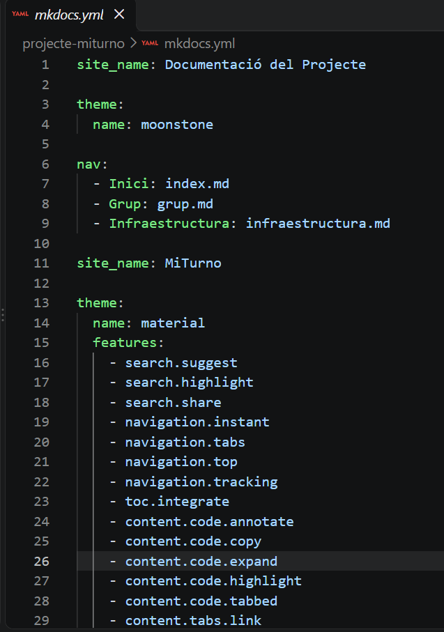

# Configuración de la web: `mkdocs.yml` y `deploy.yml`

## 1. Introducción

En este apartado explicaremos la función de los archivos `mkdocs.yml` y `deploy.yml`, que permiten configurar y publicar una página web creada con MkDocs.

También mostraremos ejemplos de los cambios realizados en ambos archivos para personalizar la página web y automatizar su publicación.

---

## 2. Archivo `mkdocs.yml`

### ¿Qué es?

El archivo `mkdocs.yml` es el archivo principal de configuración de MkDocs. Permite definir el nombre de la página web, el idioma, el tema visual, el menú de navegación y otras opciones.

### Ejemplo de configuración

```yaml
site_name: MiTurno
site_description: Documentación sobre nuestro proyecto "MiTurno" y creadores del mismo.
site_url: https://stephanebp.github.io/projecte-miturno/

theme:
  name: material
  language: es

nav:
  - Inicio: index.md
  - Configuración: configuracion.md

markdown_extensions:
  - admonition
  - tables
```

### Explicación del código

- `site_name`: define el nombre que aparece en la página web.
- `site_description`: añade una breve descripción del proyecto.
- `site_url`: indica la dirección pública de la página web.
- `theme`: selecciona el tema visual utilizado.
- `language`: establece el español como idioma del tema.
- `nav`: define las páginas que aparecen en el menú de navegación.
- `markdown_extensions`: activa extensiones adicionales de Markdown.

### Cambios realizados

Hemos personalizado el nombre de la página web, establecido el español como idioma del tema y añadido una nueva página llamada `Configuración` al menú de navegación.

**Resultado:** la web muestra un título personalizado y permite acceder directamente a la nueva página desde el menú.

### Captura de pantalla

Añade aquí una captura de tu archivo `mkdocs.yml`, donde se vean las modificaciones realizadas.



---

## 3. Archivo `deploy.yml`

### ¿Qué es?

El archivo `deploy.yml` suele definir un flujo de trabajo de GitHub Actions. Su función es automatizar tareas como instalar las dependencias, generar la web con MkDocs y publicarla en GitHub Pages.

Normalmente se encuentra en la carpeta `.github/workflows/`.

### Ejemplo de configuración

```yaml
name: Publicar web con MkDocs

on:
  push:
    branches:
      - main

permissions:
  contents: read
  pages: write
  id-token: write

jobs:
  deploy:
    runs-on: ubuntu-latest

    steps:
      - name: Descargar el repositorio
        uses: actions/checkout@v4

      - name: Configurar Python
        uses: actions/setup-python@v5
        with:
          python-version: "3.x"

      - name: Instalar MkDocs Material
        run: pip install mkdocs-material

      - name: Generar la web
        run: mkdocs build

      - name: Publicar la web
        uses: peaceiris/actions-gh-pages@v4
        with:
          github_token: ${{ secrets.GITHUB_TOKEN }}
          publish_dir: ./site
```

### Explicación del código

- `name`: asigna un nombre al proceso de publicación.
- `on`: indica cuándo se ejecuta el flujo de trabajo.
- `push`: inicia el proceso cuando se suben cambios al repositorio.
- `branches`: especifica que el proceso se ejecuta cuando hay cambios en la rama `main`.
- `jobs`: define las tareas que se deben realizar.
- `actions/checkout`: descarga el contenido del repositorio.
- `setup-python`: prepara el entorno de Python.
- `pip install mkdocs-material`: instala MkDocs Material.
- `mkdocs build`: genera los archivos HTML de la web dentro de la carpeta `site`.
- `peaceiris/actions-gh-pages`: publica el contenido generado en la rama de GitHub Pages.

### Cambios realizados

Hemos configurado un proceso automatizado para que, cuando subamos cambios a la rama `main`, GitHub Actions genere la página web y publique una nueva versión.

**Resultado:** podemos actualizar la web sin tener que generar y publicar manualmente todos los archivos cada vez que realizamos una modificación.

**Importante:** este ejemplo es orientativo. Debe adaptarse a la configuración real del repositorio y de GitHub Pages.

### Captura de pantalla

Añade aquí una captura del archivo `deploy.yml` donde se vea el proceso de publicación automática.


---

## 4. Diferencias entre ambos archivos

| Archivo | Función principal |
|---|---|
| `mkdocs.yml` | Configura el contenido, el tema, el idioma y la navegación de la web. |
| `deploy.yml` | Automatiza la generación y publicación de la web. |

En resumen, `mkdocs.yml` controla cómo se configura y se presenta la página web, mientras que `deploy.yml` determina cómo se ejecuta el proceso de publicación automatizada.

---

## 5. Comprobación de los cambios

Para comprobar que las modificaciones funcionan correctamente, seguimos estos pasos:

1. Modificamos el archivo `mkdocs.yml` y añadimos la nueva página al menú.
2. Creamos el archivo `docs/configuracion.md` con la documentación.
3. Ejecutamos el comando `mkdocs serve` en el terminal para visualizar la web localmente.
4. Comprobamos que la nueva página aparece en el menú y que el contenido se muestra correctamente.
5. Subimos los cambios al repositorio utilizando Git.
6. Accedemos a la pestaña **Actions** de GitHub para comprobar la ejecución del proceso de publicación.
7. Visitamos la web publicada para verificar que los cambios aparecen correctamente.

### Captura del resultado final

Añade una captura de la página web donde se vea el menú actualizado y la nueva página de configuración.


---

## 6. Conclusiones

Los archivos `mkdocs.yml` y `deploy.yml` son fundamentales para gestionar una página web creada con MkDocs.

El primero permite personalizar la apariencia, el idioma y la navegación de la web, mientras que el segundo permite automatizar su generación y publicación.

Gracias a estos archivos, podemos mantener la página web organizada, personalizada y actualizada de una manera más eficiente.
